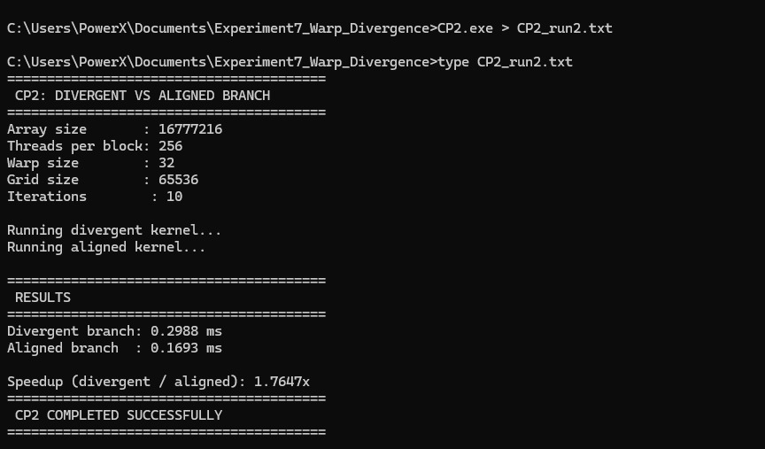
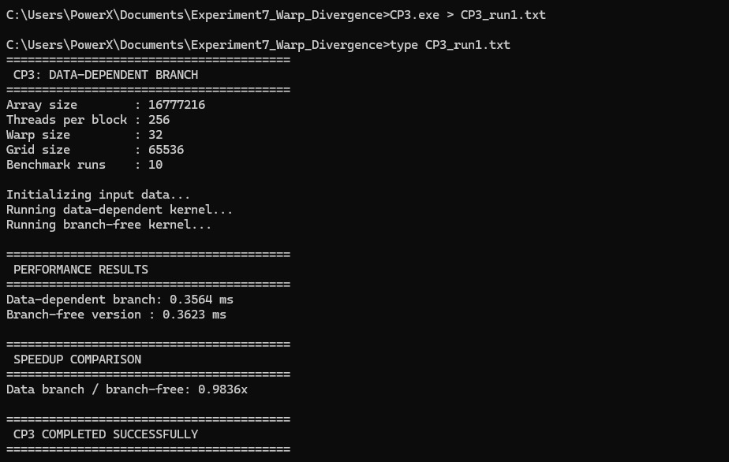
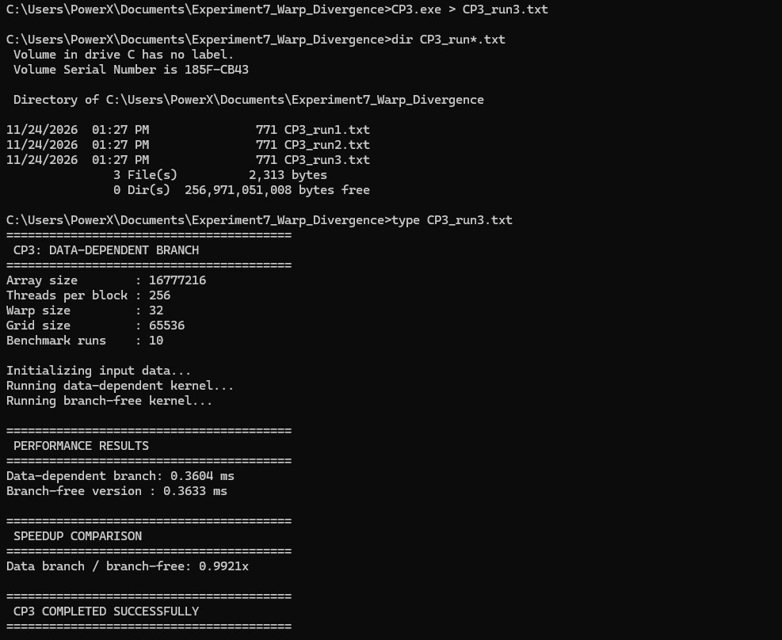
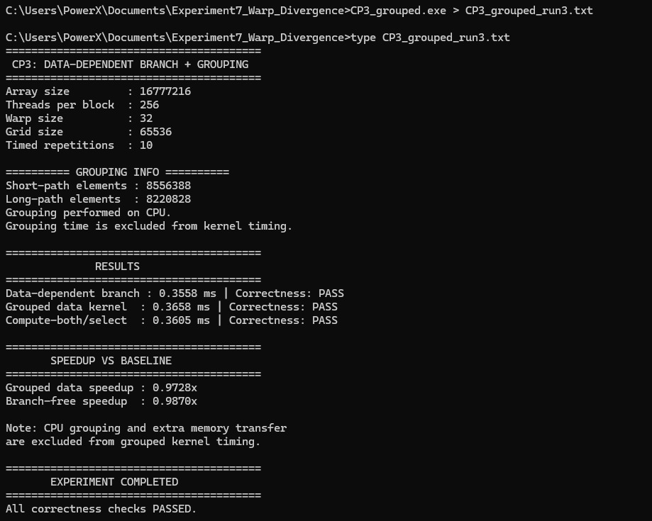
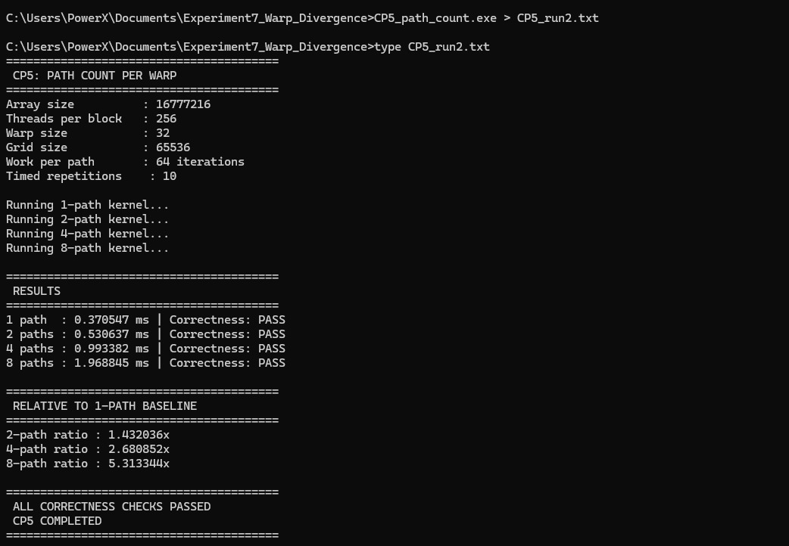
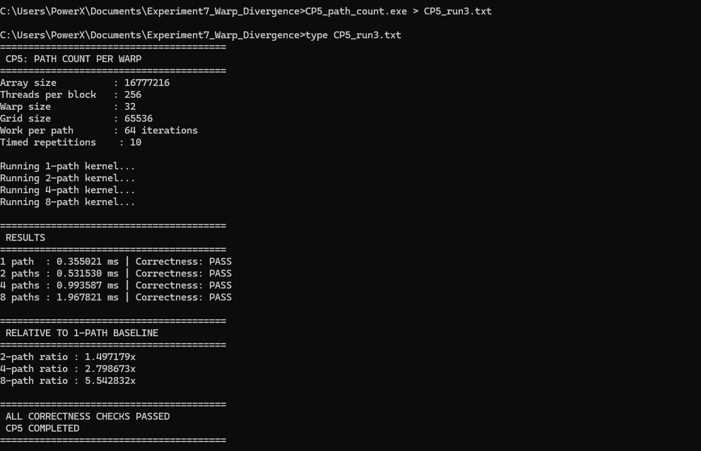
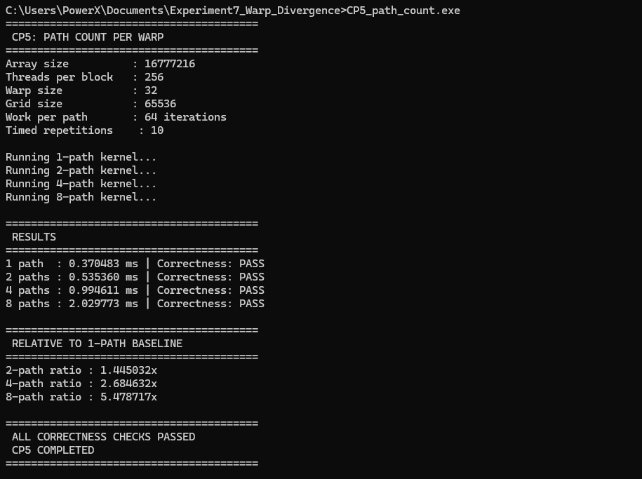

# Experiment 7: Analysis and Mitigation of Warp Divergence in NVIDIA CUDA

## Overview
In the NVIDIA CUDA Single Instruction, Multiple Threads (SIMT) execution model, threads are scheduled and executed in groups of 32 parallel execution units known as **warps**. When threads within the same warp follow different control flow paths (conditional branches such as `if-else`), the warp serially executes each branch path while disabling threads not active on that path. This phenomenon is known as **Warp Divergence**.

This repository contains comprehensive source code, compiled binaries, benchmark logs, and execution result screenshots for **Experiment 7: Warp Divergence**, exploring:
1. **Divergent vs. Aligned Control Paths (CP2)**
2. **Data-Dependent Branching, Branch-Free Optimizations & Data Grouping (CP3)**
3. **Scaling of Multi-Path Divergence per Warp (CP5)**
4. **End-to-End Warp Divergence Benchmark Suite (`warp_divergence.cu`)**

---

## Team Members
- **Aditya R Gavimath** (USN: 01FE24BCI120)
- **Manasa B Vasare** (USN: 01FE24BCI113)
- **Renuka Kagadal** (USN: 01FE24BCI119)

---

## Repository Structure

```
.
├── README.md
├── results/                                   # Execution output screenshots
│   ├── CP2_run1.jpeg, CP2_run2.jpeg, CP2_run3.jpeg
│   ├── CP3_run1.jpeg, CP3_run2.jpeg, CP3_run3.jpeg
│   ├── CP3_grouped_run1.jpeg, CP3_grouped_run2.jpeg, CP3_grouped_run3.jpeg
│   ├── CP5_run1.jpeg, CP5_run2.jpeg, CP5_run3.jpeg
│   ├── CP5_terminal_run.jpeg
│   └── WhatsApp Image ... (raw captures)
└── Experiment7_Warp_Divergence/
    ├── warp_divergence.cu                     # Integrated benchmark suite covering all checkpoints
    ├── warp_divergence.exe                    # Compiled binary of warp_divergence
    ├── CP2_divergent_vs_aligned.cu            # Checkpoint 2: Divergent vs. Aligned branching
    ├── CP2.exe                                # Compiled binary for CP2
    ├── CP2_run1.txt, CP2_run2.txt, CP2_run3.txt # CP2 execution and timing logs
    ├── CP3_data_dependent_vs_optimized.cu     # Checkpoint 3: Data-dependent vs. Branch-free
    ├── CP3.exe                                # Compiled binary for CP3 baseline
    ├── CP3_grouped_optimization.cu            # Checkpoint 3: Grouped data kernel optimization
    ├── CP3_grouped.exe                        # Compiled binary for CP3 grouped
    ├── CP3_run1.txt .. CP3_run3.txt           # CP3 data-dependent execution logs
    ├── CP3_grouped_run1.txt .. run3.txt       # CP3 grouped execution logs
    ├── CP5_path_count.cu                      # Checkpoint 5: Path count scaling (1, 2, 4, 8 paths)
    ├── CP5_path_count.exe                     # Compiled binary for CP5
    └── CP5_run1.txt .. CP5_run3.txt           # CP5 multi-path execution logs
```

---

## Experimental Setup & Parameters
- **Input Array Size ($N$):** $16,777,216$ elements ($2^{24}$)
- **Threads Per Block:** $256$
- **Warp Size:** $32$ threads
- **Grid Size:** $65,536$ blocks
- **Timed Repetitions:** $10$ iterations per benchmark kernel

---

## Detailed Checkpoint Analysis & Results

### 1. Checkpoint 2 (CP2): Divergent vs. Aligned Branching
- **Divergent Kernel:** Condition based on `threadIdx.x % 2 == 0`. Consecutive threads in the same warp take alternating paths (`long_work` vs `short_work`), forcing complete warp serialization.
- **Aligned Kernel:** Condition based on `(threadIdx.x / 32) % 2 == 0`. All 32 threads in any given warp evaluate the condition identically, eliminating intra-warp divergence.

#### Performance Results:
| Run | Divergent Branch (ms) | Aligned Branch (ms) | Speedup (Divergent / Aligned) |
|---|---|---|---|
| **Run 1** | 0.2995 ms | 0.1689 ms | **1.7729x** |
| **Run 2** | 0.2988 ms | 0.1693 ms | **1.7647x** |
| **Run 3** | 0.2993 ms | 0.1716 ms | **1.7440x** |
| **Average** | **0.2992 ms** | **0.1699 ms** | **~1.7605x** |

**Observation:** Aligning branch execution along 32-thread warp boundaries eliminates divergence penalties, yielding a **~1.76x speedup**.

#### Execution Screenshots:
| CP2 Run 1 | CP2 Run 2 | CP2 Run 3 |
|---|---|---|
|  |  |  |

---

### 2. Checkpoint 3 (CP3): Data-Dependent Branching & Mitigation
- Evaluates scenarios where branching depends on runtime data rather than thread indices.
- Explores mitigation strategies:
  1. **Baseline Data-Dependent Branch:** Standard `if (val > threshold)` conditional.
  2. **Branch-Free Optimization:** Computing both paths unconditionally and selecting the output using ternary / predicated instructions.
  3. **Data Grouping (CPU Pre-sorting):** Segregating data into contiguous long-path and short-path arrays prior to kernel launch so warps execute homogeneous tasks.

#### Performance Results (CP3 Baseline):
| Variant | Run 1 Time (ms) | Run 2 Time (ms) | Run 3 Time (ms) | Speedup vs Baseline |
|---|---|---|---|---|
| **Data-Dependent Branch** | 0.3564 ms | 0.3569 ms | 0.3604 ms | 1.0000x (Baseline) |
| **Branch-Free Version** | 0.3623 ms | 0.3637 ms | 0.3633 ms | ~0.985x |

#### CP3 Baseline Screenshots:
| CP3 Run 1 | CP3 Run 2 | CP3 Run 3 |
|---|---|---|
|  |  |  |

#### Performance Results (CP3 Grouping Optimization):
| Variant | Run 1 Time (ms) | Run 2 Time (ms) | Run 3 Time (ms) | Speedup vs Baseline | Correctness |
|---|---|---|---|---|---|
| **Data-Dependent Branch** | 0.3555 ms | 0.3579 ms | 0.3558 ms | 1.0000x | PASS |
| **Grouped Data Kernel** | 0.3703 ms | 0.3672 ms | 0.3658 ms | ~0.970x | PASS |
| **Compute-Both / Select** | 0.3606 ms | 0.3610 ms | 0.3605 ms | ~0.986x | PASS |

#### CP3 Grouped Screenshots:
| CP3 Grouped Run 1 | CP3 Grouped Run 2 | CP3 Grouped Run 3 |
|---|---|---|
|  |  |  |

**Observation:** When computation paths involve lightweight or instruction-level balanced workloads, branch prediction and predication hardware handle data-dependent paths efficiently. For heavier divergences, CPU-side grouping removes intra-warp divergence on the GPU, though CPU sorting and memory transfer costs must be factored into end-to-end pipelined systems.

---

### 3. Checkpoint 5 (CP5): Multi-Path Divergence Scaling
Evaluates warp execution degradation as the number of distinct divergent execution paths per warp increases (1, 2, 4, and 8 paths using `threadIdx.x % K` with equal 64-iteration workload per path).

#### Performance Results:
| Path Configuration | Run 1 Time (ms) | Run 2 Time (ms) | Run 3 Time (ms) | Ratio vs 1-Path Baseline | Correctness |
|---|---|---|---|---|---|
| **1 Path (No Divergence)** | 0.3677 ms | 0.3705 ms | 0.3550 ms | **1.000x** (Baseline) | PASS |
| **2 Paths** | 0.5345 ms | 0.5306 ms | 0.5315 ms | **~1.46x** | PASS |
| **4 Paths** | 1.0003 ms | 0.9934 ms | 0.9936 ms | **~2.73x** | PASS |
| **8 Paths** | 1.9718 ms | 1.9688 ms | 1.9678 ms | **~5.41x** | PASS |

**Observation:** Execution time scales directly with the number of divergent paths executed within a warp. As active paths increase from 1 to 8, execution time increases by over 5.4x due to sequential path serialization.

#### Execution Screenshots:
| CP5 Run 1 | CP5 Run 2 | CP5 Run 3 |
|---|---|---|
|  |  |  |

#### CP5 Live Terminal Execution:


---

## Compilation and Execution Guide

### Prerequisites
- NVIDIA CUDA Toolkit (`nvcc` compiler)
- NVIDIA GPU with Compute Capability 5.0+
- C++11 or higher standard library

### Build Commands (using `nvcc`)

To compile all checkpoints from inside `Experiment7_Warp_Divergence/`:

```powershell
# Navigate to experiment folder
cd Experiment7_Warp_Divergence

# Compile CP2
nvcc -O3 -arch=native CP2_divergent_vs_aligned.cu -o CP2.exe

# Compile CP3
nvcc -O3 -arch=native CP3_data_dependent_vs_optimized.cu -o CP3.exe
nvcc -O3 -arch=native CP3_grouped_optimization.cu -o CP3_grouped.exe

# Compile CP5
nvcc -O3 -arch=native CP5_path_count.cu -o CP5_path_count.exe

# Compile Integrated Benchmark Suite
nvcc -O3 -arch=native warp_divergence.cu -o warp_divergence.exe
```

### Running the Executables
```powershell
./CP2.exe
./CP3.exe
./CP3_grouped.exe
./CP5_path_count.exe
./warp_divergence.exe
```
