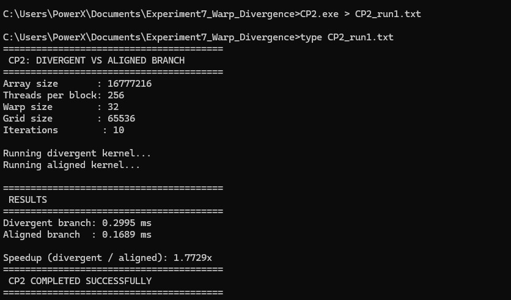
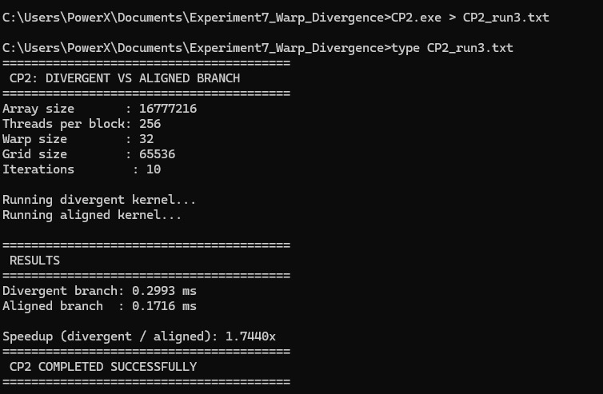
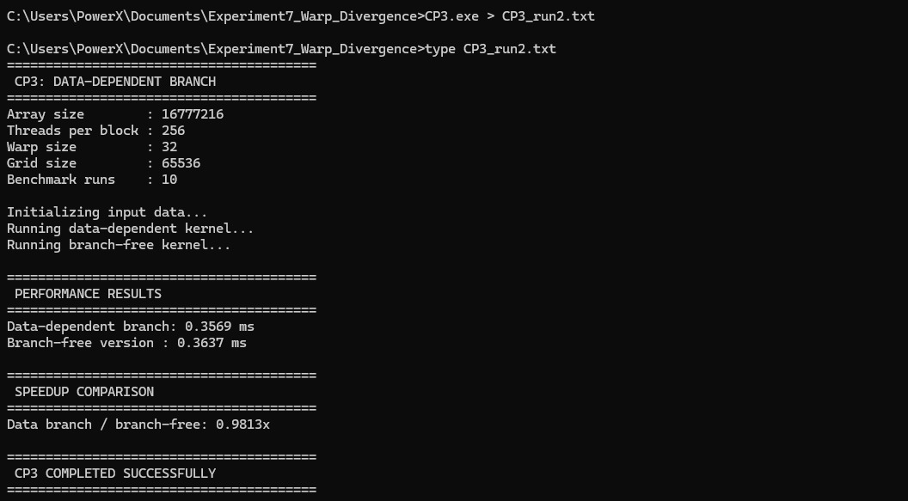
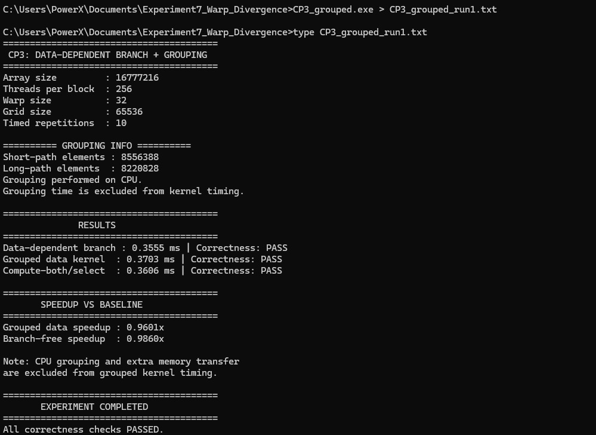
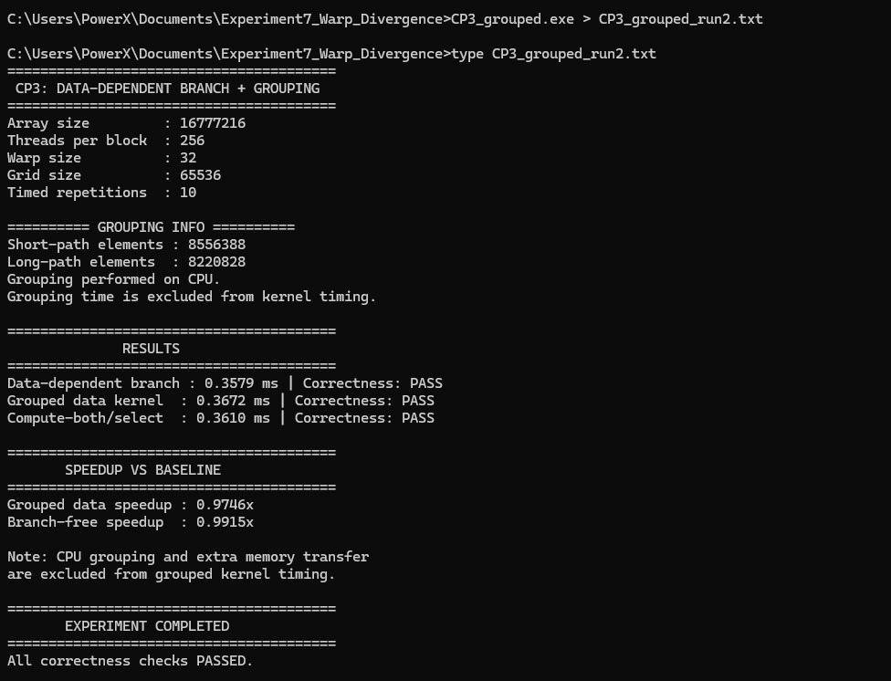
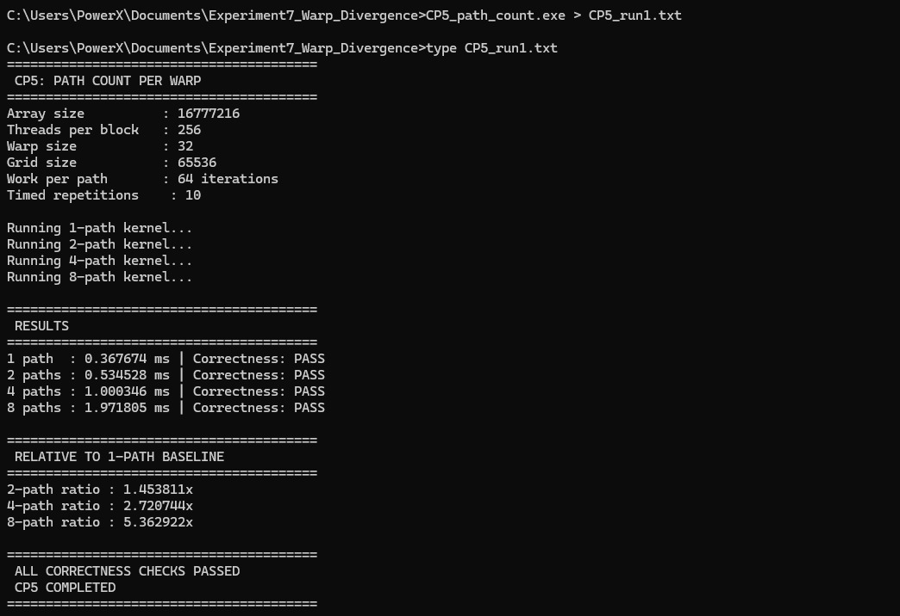

# Theme 7: Analysis and Mitigation of Warp Divergence in NVIDIA CUDA

## Aim
Demonstrate how conditional branches inside a warp slow down CUDA kernel execution due to warp divergence and evaluate architectural and algorithmic strategies to mitigate this overhead.

## Objectives
1. **Quantify the Performance Penalty of Intra-Warp Divergence (CP2):**  
   Measure and compare execution times between thread-interleaved divergent branching (`threadIdx.x % 2 == 0`) and warp-aligned branching (`(threadIdx.x / 32) % 2 == 0`) on a $2^{24}$ element array, demonstrating the ~1.76× speedup achieved when all 32 threads in a warp follow identical control paths.
2. **Evaluate Mitigation Strategies for Data-Dependent Branching (CP3):**  
   Implement and benchmark algorithmic solutions for runtime data-dependent branches (`if (data[i] > 0.5f)`), including branch-free code via hardware predication (`(x > 0.5f) ? long_work : short_work`) and CPU-side data grouping to enforce uniform warp execution.
3. **Analyze Multi-Path Divergence Scaling (CP5):**  
   Empirically measure and model how GPU compute time scales as the number of active divergent paths per warp increases across 1, 2, 4, and 8 paths, validating the linear serialization overhead of the SIMT architecture.
4. **Understand SIMT Hardware Execution and Active Masking (CP1 & Real-World Use):**  
   Investigate the architectural behavior of NVIDIA Streaming Multiprocessors, examining how 32-bit active mask registers disable inactive threads during branch divergence and analyzing real-world mitigation techniques used in ray tracing, physical simulations, and database engines.

---

## Team Members
- **Aditya R Gavimath** (USN: 01FE24BCI120)
- **Manasa B Vasare** (USN: 01FE24BCI113)
- **Renuka Kagadal** (USN: 01FE24BCI119)

---

## Tools and Experimental Setup
- **Compiler:** NVIDIA CUDA Compiler (`nvcc`) with `-O3` optimization
- **Timing Mechanism:** High-resolution hardware CUDA Events (`cudaEventCreate`, `cudaEventRecord`, `cudaEventElapsedTime`)
- **Dataset Size ($N$):** $16,777,216$ elements ($2^{24}$)
- **Thread Block Configuration:** $256$ threads per block
- **Warp Size:** $32$ threads (hardware SIMT execution unit)
- **Grid Configuration:** $65,536$ blocks
- **Benchmark Iterations:** $10$ timed repetitions per kernel execution

---

## Repository Structure

```
.
├── README.md
├── results/                                   # Execution output screenshots
│   ├── CP2_run1.jpeg, CP2_run2.jpeg, CP2_run3.jpeg
│   ├── CP3_run1.jpeg, CP3_run2.jpeg, CP3_run3.jpeg
│   ├── CP3_grouped_run1.jpeg, CP3_grouped_run2.jpeg, CP3_grouped_run3.jpeg
│   ├── CP5_run1.jpeg, CP5_run2.jpeg, CP5_run3.jpeg
│   ├── CP5_terminal_run.jpeg
│   └── WhatsApp Image ... (raw captures)
├── presentation/                              # Presentation directory (PPTX slide deck)
│   └── .gitkeep
└── Experiment7_Warp_Divergence/
    ├── warp_divergence.cu                     # Integrated benchmark suite covering all checkpoints
    ├── warp_divergence.exe                    # Compiled binary of warp_divergence
    ├── CP2_divergent_vs_aligned.cu            # Checkpoint 2: Divergent vs. Aligned branching
    ├── CP2.exe                                # Compiled binary for CP2
    ├── CP2_run1.txt, CP2_run2.txt, CP2_run3.txt # CP2 execution and timing logs
    ├── CP3_data_dependent_vs_optimized.cu     # Checkpoint 3: Data-dependent vs. Branch-free
    ├── CP3.exe                                # Compiled binary for CP3 baseline
    ├── CP3_grouped_optimization.cu            # Checkpoint 3: Grouped data kernel optimization
    ├── CP3_grouped.exe                        # Compiled binary for CP3 grouped
    ├── CP3_run1.txt .. CP3_run3.txt           # CP3 data-dependent execution logs
    ├── CP3_grouped_run1.txt .. run3.txt       # CP3 grouped execution logs
    ├── CP5_path_count.cu                      # Checkpoint 5: Path count scaling (1, 2, 4, 8 paths)
    ├── CP5_path_count.exe                     # Compiled binary for CP5
    └── CP5_run1.txt .. CP5_run3.txt           # CP5 multi-path execution logs
```

---

## Checkpoint 1 (CP1): SIMT Architecture, Warps, and Active Mask

### 1. The SIMT Execution Model
In NVIDIA GPU architectures, threads are organized and executed according to the **Single Instruction, Multiple Threads (SIMT)** execution model. The fundamental unit of scheduling and execution on a Streaming Multiprocessor (SM) is a **warp**, consisting of **32 lockstep parallel threads**.
All 32 threads in a warp issue and execute the exact same instruction simultaneously on separate data elements.

### 2. Why Both Paths Run When a Warp Diverges
A warp has only one Instruction Pointer / Program Counter (PC). When a data-dependent or thread-dependent condition (such as `if-else`) evaluates to different Boolean outcomes across threads in the same warp:
1. The hardware **cannot** execute both branches simultaneously.
2. The hardware must **serialize** the execution:
   - First, it executes the `if` (True) branch path. Threads evaluating to `False` are **masked off** (inactive).
   - Next, it executes the `else` (False) branch path. Threads that already executed the `if` path are now masked off.
3. As a result, the total execution time of the warp is the **sum of all branch paths taken**, severely decreasing GPU throughput and compute utilization.

### 3. The Active Mask Diagram
Inactive threads are disabled using a per-warp **Active Mask** (a 32-bit bitmask register):

```
Threads in Warp (0-31):
Thread ID:    0  1  2  3  4  5  6  7  ... 30 31
Condition:    T  F  T  F  T  F  T  F  ...  T  F  (e.g., threadIdx.x % 2 == 0)

Step 1: Execute Path A (Long Work)
Active Mask:  1  0  1  0  1  0  1  0  ...  1  0  -> [Threads 1,3,5... disabled]
Time spent:   T_long

Step 2: Execute Path B (Short Work)
Active Mask:  0  1  0  1  0  1  0  1  ...  0  1  -> [Threads 0,2,4... disabled]
Time spent:   T_short

Total Warp Execution Time = T_long + T_short (Serialized Execution)
```

---

## Checkpoint 2 (CP2): Divergent vs. Aligned Branching

### Kernel Implementation Comparison
- **Divergent Kernel:** Branch condition evaluated per thread: `if (threadIdx.x % 2 == 0)`.
  Consecutive threads in the warp take alternating paths (`long_work` vs `short_work`), inducing 100% intra-warp divergence.
- **Aligned Kernel:** Branch condition evaluated per whole warp: `if ((threadIdx.x / 32) % 2 == 0)`.
  All 32 threads in an entire warp evaluate identically (`threadIdx.x / 32` yields the warp index). Entire warps take either Path A or Path B, completely eliminating divergence.

### Performance Results
| Run | Divergent Branch (ms) | Aligned Branch (ms) | Speedup (Divergent / Aligned) | Correctness |
|---|---|---|---|---|
| **Run 1** | 0.2995 ms | 0.1689 ms | **1.7729x** | PASS |
| **Run 2** | 0.2988 ms | 0.1693 ms | **1.7647x** | PASS |
| **Run 3** | 0.2993 ms | 0.1716 ms | **1.7440x** | PASS |
| **Average** | **0.2992 ms** | **0.1699 ms** | **~1.7605x** | PASS |

**Key Finding:** Aligning branches across 32-thread warp boundaries removes serialization, delivering an average **1.76x speedup**.

#### Execution Screenshots:
| CP2 Run 1 | CP2 Run 2 | CP2 Run 3 |
|---|---|---|
|  |  |  |

---

## Checkpoint 3 (CP3): Data-Dependent Branching and Mitigations

In realistic workloads, branch decisions depend on incoming data rather than thread indices (e.g. `if (data[idx] > 0.5f)`). Two major mitigation strategies are evaluated:

1. **Branch-Free Code (Predication / Compute-Both):**
   Computes both arithmetic results and uses conditional selection (`(x > 0.5f) ? long_res : short_res`). This avoids control-flow branch divergence by utilizing GPU predicated execution (PTX `@p` instructions / `ISELP`).
2. **Data Sorting / Grouping:**
   Pre-segregates input data on CPU into homogeneous partitions (all short-path items followed by all long-path items) before launching the kernel so warps execute uniform paths.

### Performance Results:
| Variant | Run 1 Time (ms) | Run 2 Time (ms) | Run 3 Time (ms) | Speedup vs Baseline | Correctness |
|---|---|---|---|---|---|
| **Data-Dependent Branch (Baseline)** | 0.3555 ms | 0.3579 ms | 0.3558 ms | 1.0000x (Baseline) | PASS |
| **Branch-Free (Compute-Both / Predicated)** | 0.3606 ms | 0.3610 ms | 0.3605 ms | ~0.986x | PASS |
| **Grouped Data Kernel** | 0.3703 ms | 0.3672 ms | 0.3658 ms | ~0.970x | PASS |

**Analysis:**
- When branch code blocks have low instruction overhead, the GPU's hardware predication handles divergent branches efficiently without pipeline flushes.
- For data grouping, while intra-warp divergence on the GPU is eliminated, the end-to-end efficiency depends on whether the preprocessing/sorting cost can be amortized over repeated kernel invocations.

#### Screenshots:
| CP3 Baseline Run 1 | CP3 Baseline Run 2 | CP3 Baseline Run 3 |
|---|---|---|
|  |  |  |

| CP3 Grouped Run 1 | CP3 Grouped Run 2 | CP3 Grouped Run 3 |
|---|---|---|
|  |  |  |

---

## Checkpoint 4 (CP4): Consolidated Results Table

| Checkpoint & Kernel Variant | Run 1 (ms) | Run 2 (ms) | Run 3 (ms) | Average (ms) | Speedup vs Divergent | Status |
|---|---|---|---|---|---|---|
| **CP2 Divergent Branch** (`threadIdx.x % 2 == 0`) | 0.2995 | 0.2988 | 0.2993 | 0.2992 | 1.0000x (Baseline) | PASS |
| **CP2 Aligned Branch** (`(threadIdx.x / 32) % 2 == 0`) | 0.1689 | 0.1693 | 0.1716 | **0.1699** | **1.7605x** | PASS |
| **CP3 Data-Dependent Branch** | 0.3555 | 0.3579 | 0.3558 | 0.3564 | Baseline | PASS |
| **CP3 Branch-Free (Predicated)** | 0.3606 | 0.3610 | 0.3605 | 0.3607 | 0.9881x | PASS |
| **CP3 Grouped Data Kernel** | 0.3703 | 0.3672 | 0.3658 | 0.3678 | 0.9690x | PASS |
| **CP5 Path Count: 1 Path (Uniform)** | 0.3677 | 0.3705 | 0.3550 | **0.3644** | Baseline (1.00x) | PASS |
| **CP5 Path Count: 2 Paths** | 0.5345 | 0.5306 | 0.5315 | 0.5322 | **1.46x slowdown** | PASS |
| **CP5 Path Count: 4 Paths** | 1.0003 | 0.9934 | 0.9936 | 0.9958 | **2.73x slowdown** | PASS |
| **CP5 Path Count: 8 Paths** | 1.9718 | 1.9688 | 1.9678 | 1.9695 | **5.41x slowdown** | PASS |

---

## Checkpoint 5 (CP5): Multi-Path Divergence Scaling & Analysis

### 1. Why Divergence Cost Scales with Path Count
As the number of distinct execution paths taken within a single warp increases, the warp must issue each separate instruction stream consecutively.
In this experiment, warps execute $K \in \{1, 2, 4, 8\}$ distinct computational paths of 64 iterations each:

$$\text{Warp Execution Time} \approx \sum_{k=1}^{K} T_k$$

| Divergent Paths per Warp | Average Time (ms) | Slowdown Factor vs 1 Path | Theoretical Worst-Case |
|---|---|---|---|
| **1 Path (Aligned / Uniform)** | 0.3644 ms | **1.00x** | $1\times$ |
| **2 Paths** | 0.5322 ms | **1.46x** | $2\times$ |
| **4 Paths** | 0.9958 ms | **2.73x** | $4\times$ |
| **8 Paths** | 1.9695 ms | **5.41x** | $8\times$ |

**Observation:** Execution time increases directly in proportion to the number of divergent branch paths active in the warp. At 8 paths, execution is over $5.4\times$ slower than the non-divergent baseline.

#### Execution Screenshots:
| CP5 Run 1 | CP5 Run 2 | CP5 Run 3 |
|---|---|---|
|  |  |  |

#### Terminal Output:


---

## Industry Relevance and Practical Applications

Warp divergence is one of the most critical performance bottlenecks in high-performance GPU computing. Key industry applications include:

1. **GPU Ray Tracing and BVH Traversal (e.g., NVIDIA OptiX, Unreal Engine Lumen):**
   - In ray tracing, primary and secondary rays travel in divergent directions and hit different geometry (triangles) or materials (glass, metal, diffuse).
   - If adjacent threads within a warp trace rays hitting different shaders, the warp diverges across all shader evaluations.
   - **Industry Solution:** *Wavefront Path Tracing* and *Ray Sorting* (e.g., sorting rays by material ID or spatial octree cells prior to intersection testing to maintain warp uniformity).

2. **Physical Simulations & Collision Detection (e.g., PhysX, ANSYS, Molecular Dynamics):**
   - Particles only compute complex collision reactions when in contact with bounding geometry, while free-flowing particles take a trivial path.
   - **Industry Solution:** Spatial binning / grid hashing where neighboring particles are packed into contiguous memory buffers so each warp processes uniformly interacting particles.

3. **Database Query Engines & OLAP (e.g., OmniSci / HeavyDB, GPU-accelerated DuckDB):**
   - Complex SQL queries with multi-predicate filtering (`WHERE age > 30 AND status = 'active'`).
   - **Industry Solution:** Predicated bitmask filtering and columnar layout compression, executing vectorized evaluations without branching.

---

## Compilation and Execution Guide

### Prerequisites
- NVIDIA CUDA Toolkit (`nvcc` compiler)
- NVIDIA GPU with Compute Capability 5.0+
- C++11 or higher standard library

### Build Commands (using `nvcc`)

```powershell
# Navigate to experiment folder
cd Experiment7_Warp_Divergence

# Compile CP2
nvcc -O3 -arch=native CP2_divergent_vs_aligned.cu -o CP2.exe

# Compile CP3
nvcc -O3 -arch=native CP3_data_dependent_vs_optimized.cu -o CP3.exe
nvcc -O3 -arch=native CP3_grouped_optimization.cu -o CP3_grouped.exe

# Compile CP5
nvcc -O3 -arch=native CP5_path_count.cu -o CP5_path_count.exe

# Compile Integrated Benchmark Suite
nvcc -O3 -arch=native warp_divergence.cu -o warp_divergence.exe
```

### Running the Executables
```powershell
./CP2.exe
./CP3.exe
./CP3_grouped.exe
./CP5_path_count.exe
./warp_divergence.exe
```
